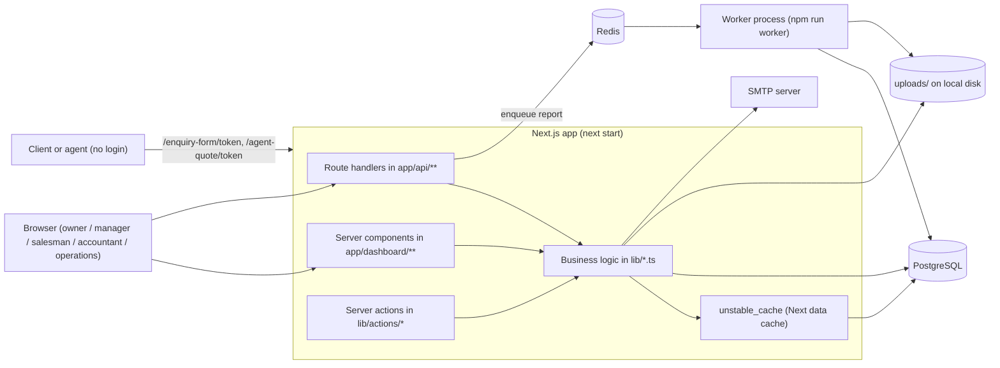
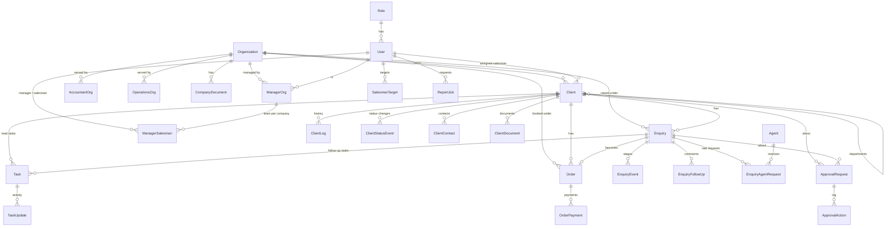

# SalesPal Architecture

Logistics sales management: clients and leads, enquiries and quotes, orders and payments, approvals, targets and reports, across several companies (organizations).

> Keep this file in step with the code. When you change `prisma/schema.prisma`, roles/scoping, a route, an env var or the deployment, update the matching section here. Function-level detail lives in [FUNCTION-CATALOG.md](FUNCTION-CATALOG.md).

## 1. Stack

| Layer | Choice | Where |
|---|---|---|
| Framework | Next.js 16 (App Router), React 19 | `app/` |
| Language | TypeScript | everywhere |
| Database | PostgreSQL via Prisma 6 | `prisma/schema.prisma`, `lib/prisma.ts` |
| Auth | NextAuth v4, credentials (email + password), JWT sessions | `lib/auth.ts`, `app/api/auth/[...nextauth]` |
| Queue | BullMQ on Redis (report building only) | `lib/report-queue.ts`, `worker/index.mts` |
| PDF | `@react-pdf/renderer`, `pdf-lib` | `lib/report-pdf.tsx`, `lib/enquiry-form-pdf.ts` |
| Email | Nodemailer (SMTP) | `lib/mailer.ts` |
| UI | Tailwind 4, Radix UI, Mantine charts, Recharts, lucide icons | `components/`, `styles/` |
| Hosting | Coolify on a VPS, `next start` + a separate worker process | see section 9 |

Next.js 16 has breaking changes against older versions. `AGENTS.md` tells you to read `node_modules/next/dist/docs/` before changing framework-level code. `proxy.ts` is the Next 16 name for middleware.

## 2. System overview

Request path in short: a page (server component) or route handler authenticates with `getSalesPalSession()`, builds a role-based `where` from `lib/scoping.ts`, reads or writes through Prisma, then calls `revalidateTag`/`revalidatePath` so cached views refresh.

## 3. Folder map

| Path | What is in it |
|---|---|
| `app/(auth)/login` | Login page |
| `app/dashboard/{admin,manager,salesman,accountant,operations}` | One page tree per role (section 6) |
| `app/enquiry-form/[token]`, `app/agent-quote/[token]` | Public pages reached by emailed links; no login |
| `app/api/**` | Route handlers (section 7) |
| `lib/` | Business logic, queries, calculations, scoping, file storage |
| `lib/actions/` | Server actions: `approval-actions`, `company-actions`, `manager-actions`, `user-actions` |
| `lib/cached-queries.ts` | All `unstable_cache` wrappers and their cache tags |
| `components/` | UI: `layout`, `ui`, `dashboard`, `clients`, `companies`, `reports`, `salesmen` and more |
| `hooks/` | Client hooks: `useKpi`, `useShippingRates`, `useTasks`, `useUrlFilters` |
| `types/` | Status lists, labels and shared TypeScript types per domain |
| `worker/index.mts` | BullMQ worker that builds report PDFs |
| `prisma/` | `schema.prisma`, seed scripts, one-off SQL scripts (section 5.3) |
| `scripts/perf` | Performance scripts |
| `tests/` | `order-payments.test.ts`, `rate-limit.test.ts` (run with `npm test`) |
| `uploads/` | Files saved to local disk (section 8) |
| `proxy.ts` | Redirects `/home` to `/` |

## 4. Roles, authentication and data scoping

### 4.1 Roles

Defined in `lib/roles.ts` (seed list in `prisma/add-roles.sql`).

| id | Name | Home page | Sees |
|---|---|---|---|
| 1 | Owner | `/dashboard/admin` | Everything, all companies |
| 6 | Super Admin | `/dashboard/admin` | Owner's menu plus Orders, Tasks, Shipping Rates; may act on any approval step |
| 2 | Manager | `/dashboard/manager` | Companies assigned in `manager_org`; the team in `manager_salesman` |
| 3 | Salesman | `/dashboard/salesman/dashboard-org` | Own clients, enquiries, orders, tasks |
| 4 | Accountant | `/dashboard/accountant` | Orders and enquiries of companies in `accountant_org` |
| 5 | Operations | `/dashboard/operations/enquiries` | Enquiries and shipping rates of companies in `operations_org` |

`isOwnerRole()` is true for roles 1 and 6. The menu per role is `lib/nav-config.ts`; icons and grouping are in `components/layout/nav-meta.ts`.

### 4.2 Sign-in

`lib/auth.ts`:
- Email is trimmed and lower-cased; password checked with bcrypt.
- Rate limit: 5 attempts per email and 30 per IP per 15 minutes, **in process memory** (`lib/rate-limit.ts`). With more than one app instance each keeps its own count.
- JWT session lasts 8 hours. Every 5 minutes the role is re-read from `users`; a deleted user gets role `0` and is locked out.
- Token carries `id`, `role_id`, `org_ids` (manager's companies) and `manager_ids` (salesman's managers) from login time. Treat these two as possibly stale; scoping code re-reads from the database instead.
- Secret: `NEXTAUTH_SECRET`.

### 4.3 Scoping (who sees which rows)

`lib/scoping.ts` is the single place that turns a role into a Prisma `where`. It re-reads assignments on every request so owner changes apply without a re-login.

| Helper | Returns |
|---|---|
| `clientScopeWhere` | Owner: all. Manager: clients in their companies. Salesman: `assigned_salesman_id = self`. Others: nothing |
| `orderScopeWhere` | Owner: all. Accountant and manager: orders in their companies (`org_id`). Salesman: `created_by_id = self` |
| `taskScopeWhere` | Task visibility per role |
| `getManagerOrgIds`, `getAccountantOrgIds`, `getOperationsOrgIds` | Company ids for those roles |
| `getSalesmanOrgIds` | Companies a salesman works for (from `manager_salesman`) |
| `getManagerSalesmanIds`, `getManagerSalesmanIdsForOrg` | A manager's team, overall or per company |

Approvals have their own scope in `lib/approvals.ts` (`approvalScopeWhere`, `approvalQueueWhere`).

**Key rule:** a salesman belongs to a manager *per company* (`manager_salesman` has `org_id`). The same salesman can sit under two managers, or in two companies, as separate rows. Anything that counts people per company must filter on `org_id` and de-duplicate.

## 5. Database

### 5.1 Connection

- `datasource db` is PostgreSQL, URL from `DATABASE_URL`.
- `lib/prisma.ts` exports one shared `PrismaClient`. In development it is stored on `globalThis` so hot reload does not open new connections. Logs `error` (plus `warn` in development).
- `npm run build` runs `prisma generate` before `next build`.
- The worker and seed scripts use the same client.

### 5.2 Entity relationship diagram

### 5.3 Schema management

- Only two Prisma migrations exist (`prisma/migrations`, June 2026 init). Later schema changes were applied with `npm run prisma:push` (`prisma db push`) and the one-off scripts in `prisma/*.sql` (backfills such as `backfill-paid-total.sql`, `backfill-client-status-events.sql`, and status migrations). So migrations do not reproduce the live schema; **`schema.prisma` is the source of truth** and a fresh database is created with `db push`.
- Seeds: `prisma/seed.ts` (`npm run prisma:seed`, honours `SEED_SIZE`, `SEED_FORCE`), `prisma/seed-super-admin.ts` (`SUPER_ADMIN_EMAIL/NAME/PASSWORD`).
- Money is `Decimal(12,2)`; weights and volumes `Decimal(12,3)`. Dates that mean a calendar day are `@db.Date`.
- Cascade rules: deleting a client cascades to its logs, contacts, documents, tasks, enquiries, orders and approvals. Deleting an organization is **not** cascaded to clients, enquiries or orders (no `onDelete`), so those block the delete.

### 5.4 Tables and columns

Table name in the database is in brackets. Types are the Prisma types. `?` means nullable.

#### Roles, companies, people

**Role** [`roles`]: `id` (fixed ids 1 to 6), `name` unique.

**Organization** [`organizations`] (a company)
| Column | Type | Notes |
|---|---|---|
| id | Int PK | |
| name | String unique | |
| address, phone, email, note | String? | |
| prefix | String? unique | 2 to 6 chars A-Z/0-9; enquiry ids like `SPA-ENQ-00012` |
| export_office_no, customs_code, import_office_no | String? | Registration numbers shown on enquiry PDFs |
| logo_path | String? | PNG/JPG under `uploads/companies/<id>/logo/` |
| created_at | DateTime | |

**User** [`users`]: `id`, `name`, `role_id` to Role, `email` unique, `password` (bcrypt hash), `phone?`. Many relations (assigned clients, tasks, orders created and so on).

**ManagerOrg** [`manager_org`]: PK (`manager_id`, `org_id`). Manager runs the company. Deleting cascades to that company's team rows.

**AccountantOrg** [`accountant_org`]: PK (`accountant_id`, `org_id`).

**OperationsOrg** [`operations_org`]: PK (`user_id`, `org_id`).

**ManagerSalesman** [`manager_salesman`]: PK (`manager_id`, `salesman_id`, `org_id`). A salesman under a manager for one company. FK (`manager_id`, `org_id`) to ManagerOrg, so removing the manager from a company removes the team there. Indexes on (`salesman_id`, `org_id`) and `org_id`.

**CompanyDocument** [`company_documents`]: `org_id`, `label`, `doc_number?`, `expiry_date?`, `file_name`, `file_path` (relative to `uploads/`), `mime_type`, `size_bytes`, `uploaded_by_id`, timestamps.

#### Clients

**Client** [`clients`]
| Column | Type | Notes |
|---|---|---|
| id | Int PK | |
| name, contact_person_name, contact_no | String | Main contact lives here; extra people in `client_contacts` |
| contact_person_designation, mail_id, location_coordinates, notes | String? | |
| cr_no | String? unique | Commercial registration number |
| cr_expiry_date | Date? | |
| assigned_salesman_id | Int to User | Owner of the client; scoping key for salesmen |
| org_id | Int to Organization | |
| status | String | `lead, contacted, follow_up, enquiry, onboarded, dormant, lost, blacklisted` (`types/client.ts`) |
| status_changed_at | DateTime | Entered current status; used for aging |
| category | String, default `standard` | `standard` or `premium` |
| department | String? | A company handled per department is one row per department |
| parent_client_id | Int? self FK | Main row for a department row; department rows show the parent's `cr_no` |
| checklist_* (8 booleans) | Boolean | `kyc_verified, agreement_signed, rate_card_approved, integration_setup, dispatch_confirmed, billing_verified, portal_created, first_shipment` |
| credit_approved | Boolean | Set when a credit agreement is fully approved |
| credit_days_approved | Int? | |
| credit_approved_at | DateTime? | |
| created_at | DateTime | |

Indexes: salesman, org, (org, status), (salesman, status), status, category, created_at, parent.

**ClientLog** [`client_logs`]: `client_id`, `action` (text line shown as history), `done_by`, `created_at`.

**ClientStatusEvent** [`client_status_events`]: one row per status change; source of pipeline metrics. `from_status?`, `to_status`, `owner_id` (salesman credited), `actor_id?` (null for automatic), `org_id`, `source` (`manual, lead_outcome, enquiry, order, dormant_sweep, create`). Written only by `applyClientStatus`, client creation and the dormant sweep.

**ClientContact** [`client_contacts`]: `client_id`, `name`, `designation?`, `phone?`, `email?`, `created_by_id`.

**ClientDocument** [`client_documents`]: `client_id`, `description`, `doc_type?` (`cr`, `computer_card`, `signatory_id` for KYC), `expiry_date?`, file columns as for company documents, `uploaded_by_id`.

**ImportBatch** [`import_batches`]: one bulk client CSV import (`file_name`, `org_id/org_name`, `total_rows`, `failed_rows`, `status` `importing|completed|reversed|partially_reversed`, `created_by_*`, reversal fields). `clients.import_batch_id` points at it; reversing deletes the batch's clients that have no enquiries, orders, approvals or departments (`reverseImportBatch`).

**Deployment** [`deployments`]: `version`, `commit?`, `deployed_at`, `note?`. A row is added on server start when version/commit differ from the latest row (`instrumentation.ts` → `lib/deployments.ts`).

**ErrorLog** [`error_logs`]: errors grouped by `fingerprint` (source + message + route with ids stripped): `source` (`server|client`), `message`, `stack?`, `path`, `count`, `first_seen/last_seen`, `status` (`open|resolved`; a repeat reopens it). Written by `onRequestError` in `instrumentation.ts` and by `app/dashboard/error.tsx` via `POST /api/error-log`.

**SalesmanKpiLog** [`salesman_kpi_logs`]: `salesman_id`, `action`. Minimal log table.

#### Tasks

**Task** [`tasks`]
| Column | Type | Notes |
|---|---|---|
| assigned_to_id, created_by_id | Int to User | |
| description, due_date | String, DateTime | |
| notification | Boolean | |
| status | String | `pending, in_process, achieved, unsuccessful` |
| category | String? | `client_follow_up` (a task about one client; this is what used to be the separate `client_tasks` table, now merged into tasks), `order_follow_up`, `payment_follow_up`, plus `order_revision` and `lead_follow_up` constants in `types/task.ts` |
| enquiry_id | Int? | Automatic 30-day enquiry follow-ups |
| client_id | Int? | Lead follow-up; its outcome updates the client |
| outcome | String? | `contacted, follow_up, rejected` |
| closed_at | DateTime? | Closed tasks are deleted after 6 months by the cron |

**TaskUpdate** [`task_updates`]: activity per task: `action` (`contacted, follow_up, rejected, enquiry_follow_up, enquiry_stage, enquiry_closed, status, reassigned`), `note?`, `prev_due_date?`, `new_due_date?`, `created_by_id`.

#### Enquiries and quotes

**Enquiry** [`enquiries`]
| Group | Columns |
|---|---|
| Identity | `id`, `client_id`, `org_id` (defaults to client's), `enquiry_date` (Date), `created_by_id`, `created_at`, `updated_at` |
| Route | `mode`, `from`, `to`, `collection_address?`, `job_ref?` (e.g. SEFL), `incoterm?` (Incoterms 2020) |
| Terms | `payment_mode`, `credit_days?` (only credit), `clearance` (bool), `notes?` |
| Dangerous goods | `is_dg` (bool), `un_number?` (normalised `UN1203, UN1950`) |
| Cargo | `packages?` (Json list of `{length,width,height,qty}`), `dimension_unit?` (`cm,m,ft,in`), `actual_weight?` (always kg), `weight_unit?` (`kg,lb`), `stackable?`, `chargeable_weight?` (kg), `cbm?` |
| Service | `service_type?` (sea: `20dc,40dc,40hc,20ot,40ot,20fr,40fr,20rf,40rf,lcl,ro_ro,break_bulk`), `reefer_temp?` (deg C), `gauge?` (`ig,og`), `truck_type?` (land) |
| Money | `provisional_cost?`, `provisional_profit?` (set when quoted), `actual_cost?`, `actual_profit?` (filled by accounts on the order) |
| Status | `status` default `inquiry_received`: `sent_to_client, inquiry_received, with_agent, quoted, revision_requested, confirmed, lost` |
| Lost | `cancel_reason?`, `lost_reason?` (`high_rate, late_quote, dispute, credit_terms, other`), `cancelled_at?`, `cancelled_by_id?` |
| Client form | `client_form_token?` unique, `client_form_email?`, `client_form_sent_at?`, `client_signed_name?`, `client_signed_at?`, `client_signature_path?` |
| Follow-up | `next_follow_up_at?` (Date; null means enquiry_date + 30 days) |
| Approval | `needs_approval` (bool), `approval_status?` (`pending, approved, rejected`) |

**EnquiryEvent** [`enquiry_events`]: stage history: `action`, `from_status?`, `to_status?`, `prev_cost?`, `prev_profit?`, `cost?`, `profit?`, `note?`, `order_id?`, `created_by_id`.

**EnquiryFollowUp** [`enquiry_follow_ups`]: `enquiry_id`, `comment`, `created_by_id`.

**Agent** [`agents`]: freight partner: `name`, `contact_person?`, `email`, `phone?`, `extra_emails[]`, `extra_phones[]`, `country?`, `network?`, `code?`, `modes[]` (`air, sea, land`), `locked`.

**EnquiryAgentRequest** [`enquiry_agent_requests`]: one "send to agent" rate request: `enquiry_id`, `agent_id`, `token` unique (link `/agent-quote/<token>`), `sent_by_id`, `sent_at`, reply fields `cost?`, `notes?`, `replied_at?`.

#### Orders and money

**Order** [`orders`]
| Column | Type | Notes |
|---|---|---|
| client_id, org_id | Int | Company is the enquiry's, else the client's |
| mode, description, payment_mode, from, to | String | |
| amount | Decimal(12,2) | Order value |
| advance_amount | Decimal(12,2) | Paid up front |
| paid_total | Decimal(12,2) | `advance_amount` + all payments. Denormalised; kept by `syncOrderPayments()` |
| status | String, default `transit` | `transit, delivered, completed, revision_requested, cancelled` |
| closed_reason | String? | For cancelled or revision |
| accounts_approval, manager_approval | String | **Retired**, kept for history (default `pending`) |
| created_by_id | Int | Salesman scoping key |
| enquiry_id | Int? unique | Enquiry it currently fulfils; cleared on revision |
| origin_enquiry_id | Int? | Enquiry it came from; kept for history |
| job_no | String? unique | |
| invoice_date, due_date | Date? | Due = invoice date + credit days for credit orders |
| created_at, updated_at | DateTime | |

**OrderPayment** [`order_payments`]: payments after the advance: `order_id`, `amount`, `paid_on` (Date), `method`, `reference?`, `notes?`, `recorded_by_id`.

**ShippingRate** [`shipping_rates`]: `location`, `port`, `carrier?`, `mode`, `container`, `price`, `currency?` default `QAR`, `updated_by_id`. Unique on (`location`, `port`, `mode`, `container`).

#### Targets, approvals, reports

**SalesmanTarget** [`salesman_targets`]: `salesman_id`, `set_by_id`, `amount`, `period_start`, `period_end` (Dates), `closed_at?` (set when a manager replaces it early).

**ApprovalRequest** [`approval_requests`]: `type` (`credit_agreement`, `enquiry`), `org_id`, `client_id`, `enquiry_id?`, `requested_by_id`, `status` (`pending, approved, rejected, cancelled`), `current_step` (index into the type's steps), `data` (Json: the form or a quote snapshot), `decided_at?`. Decided requests are deleted after 6 months.

**ApprovalAction** [`approval_actions`]: the log: `request_id`, `step` (-1 = submitted), `action` (`submitted, approved, rejected, cancelled`), `comment?`, `actor_id`.

**ReportJob** [`report_jobs`]: `type`, `params` (Json), `requested_by`, `status` (`queued, running, done, failed`), `file_path?`, `file_name?`, `error?`, `finished_at?`. PDFs kept 30 days.

### 5.5 Status flows (summary)

Client status (`lib/client-status-flow.ts`):
- Raise an enquiry: `lead / contacted / follow_up / lost` becomes `enquiry`; `dormant` returns to `onboarded`.
- First order: anything short of `onboarded` becomes `onboarded`.
- 60 quiet days: `onboarded` becomes `dormant` (`sweepDormantClients`).
- Only managers and owners may set or clear `blacklisted`; blacklisted clients get no new enquiries or orders.

Enquiry: `sent_to_client` or `inquiry_received` then `with_agent` then `quoted` then `confirmed` (creates the order) or `lost`; `revision_requested` when accounts send an order back. Active statuses get 30-day follow-up tasks.

Order: `transit`, `delivered`, `completed`, with `revision_requested` and `cancelled` as exits.

Approvals (`lib/approvals.ts`, `types/approval.ts`): `credit_agreement` goes accounts, manager, owner; `enquiry` goes to manager. Super admin may act on any step.

## 6. Pages (App Router)

All under `app/dashboard/<role>/`. Each role has its own tree.

| Role | Pages |
|---|---|
| admin | (overview), accounts, control-panel (super admin only: imports + reverse, deployments, errors), agents, approvals, clients, clients/[id], companies, enquiries, orders, reports, salesmen, shipping-rates, tasks, users |
| manager | (team overview), my-overview, team, team/[salesmanId], tasks, my-clients, clients, clients/[id], salesmen, enquiries, orders, shipping-rates, agents, approvals, reports |
| salesman | dashboard-org, (overview), tasks, clients, clients/[id], enquiries, orders, orders/[id] |
| accountant | (dashboard), enquiries, orders, shipping-rates, agents, approvals |
| operations | enquiries, shipping-rates |
| all roles | `/dashboard/calendar` (task calendar: month / week / year, opened from the top bar icon; data from `lib/calendar.ts` via `GET /api/calendar`) |
| public | `/login`, `/enquiry-form/[token]`, `/agent-quote/[token]` |

Data for dashboards is assembled in `lib/admin-dashboard.ts`, `manager-dashboard.ts`, `accountant-dashboard.ts`, `owner-accounts.ts`, `performance.ts`, `pipeline-metrics.ts`, and streamed section by section with `Suspense` (`components/dashboard/*Sections.tsx`).

## 7. API routes (`app/api`)

| Area | Routes (methods) |
|---|---|
| Auth | `auth/[...nextauth]` |
| Users | `users` (POST), `users/reset-password` (POST) |
| Clients | `clients` (GET, POST), `clients/[id]` (GET, PATCH), `/status`, `/checklist`, `/contacts`, `/contacts/[contactId]`, `/documents`, `/documents/[docId]`, `/tasks`, `/tasks/[taskId]`, `clients/bulk-assign` |
| Enquiries | `enquiries` (GET, POST), `enquiries/[id]` (PATCH), `/stage`, `/cancel`, `/follow-ups`, `/send-to-agent`, `/signature`, `enquiries/send-to-client`, `enquiries/follow-ups/sync` |
| Public forms | `enquiry-form/[token]` (POST), `agent-quote/[token]` (POST) |
| Orders | `orders` (GET, POST), `orders/[id]` (GET, PATCH), `/status`, `/payments`, `/reminder`, `orders/stats` |
| Tasks | `tasks` (GET, POST), `tasks/[id]` (PATCH, DELETE), `/follow-up`, `/outcome`, `/updates` |
| Agents | `agents` (GET, POST), `agents/[id]` (PATCH, DELETE) |
| Shipping rates | `shipping-rates` (GET, POST), `shipping-rates/[id]` (PATCH, DELETE) |
| Companies | `companies/[id]/documents` (POST), `/documents/[docId]`, `/documents/export`, `/logo` |
| Team | `manager-org`, `manager-salesman` (POST, DELETE), `salesman-targets` (POST) |
| Reports | `reports/company`, `reports/salesman/[id]`, `reports/jobs` (GET, POST), `reports/jobs/[id]/file` |
| Control panel | `import-batches` (POST start), `import-batches/[id]/finish`, `error-log` (POST from the browser); reverse / resolve are server actions in `lib/actions/control-panel-actions.ts` |
| Calendar | `calendar` (GET `?from&to&mode=rows|summary&user`) |
| Misc | `activity`, `kpi/[userId]`, `cron/cleanup-tasks` |

Server actions (`lib/actions/`) cover company, user, manager-team and approval changes made from forms.

Convention: handlers call `getSalesPalSession()`, return `401` when there is no session, check the role, then use a scope helper from section 4.3.

## 8. Files and uploads

- Stored on the **server's local disk** under `uploads/` (`lib/company-documents.ts`: `UPLOAD_ROOT = <cwd>/uploads`). Paths in the database are relative to it; a path-traversal check rejects anything outside the root.
- Layout: `companies/<id>/logo/`, `clients/<id>/`, `enquiries/<id>/` (signatures), `reports/<jobId>.pdf`.
- On Coolify, `uploads/` must be a **persistent volume** shared by the app and the worker, or files are lost on redeploy and the worker's reports are not visible to the app.

## 9. Background work, caching and scheduled jobs

**Reports (queue):** `POST /api/reports/jobs` inserts a `report_jobs` row and adds a job to the BullMQ queue `reports` (`lib/report-queue.ts`: 2 attempts, 3 s fixed backoff). `worker/index.mts` (concurrency 1, 120 s lock) builds the PDF with `buildCompanyReportPdf`, writes `reports/<id>.pdf`, and updates the row. It marks the row `failed` only after retries run out. Redis URL: `REDIS_URL` (default `redis://127.0.0.1:6379`). Redis is used for the queue only.

**Caching:** `lib/cached-queries.ts` wraps heavy reads in `unstable_cache` with a `revalidate` time (15 s to 300 s) and tags such as `admin-dashboard`, `admin-companies`, `salesman-clients`, `order-stats`, `shipping-rates`. Writes call `revalidateTag` / `revalidatePath` (for example `revalidateTeamViews()`, `revalidateTaskViews()`). When you change the shape a cached query returns, change its cache key too, or the old shape is served for up to the revalidate time.

**Cron:** `POST /api/cron/cleanup-tasks` with `Authorization: Bearer $CRON_SECRET`, daily (for example 03:00). It deletes closed tasks older than 6 months, decided approvals older than 6 months, and report jobs plus PDFs older than 30 days. It returns `503` if `CRON_SECRET` is unset.

**Email:** `lib/mailer.ts` via SMTP; used for client forms and agent rate requests.

## 10. Environment variables

| Variable | Used for |
|---|---|
| `DATABASE_URL` | PostgreSQL connection (Prisma) |
| `NEXTAUTH_SECRET` | Signs sessions and checks tokens in API routes |
| `REDIS_URL` | BullMQ connection (default `redis://127.0.0.1:6379`) |
| `APP_URL` | Absolute links in emails (`lib/public-url.ts`) |
| `SMTP_HOST`, `SMTP_PORT`, `SMTP_SECURE`, `SMTP_USER`, `SMTP_PASS`, `MAIL_FROM` | Outgoing mail |
| `CRON_SECRET` | Enables and protects the cleanup endpoint |
| `SOURCE_COMMIT` | Set by Coolify; shown as the commit in the sidebar (build time) |
| `SUPER_ADMIN_EMAIL`, `SUPER_ADMIN_NAME`, `SUPER_ADMIN_PASSWORD` | `seed:super-admin` |
| `SEED_SIZE`, `SEED_FORCE` | `prisma/seed.ts` |

`NEXT_PUBLIC_APP_VERSION` and `NEXT_PUBLIC_COMMIT` are set in `next.config.ts` from `package.json` and `SOURCE_COMMIT`.

## 11. Deployment and operations

- Two processes from the same repo: the web app (`npm run build`, `npm start`) and the worker (`npm run worker`, bundled with esbuild to `.worker/index.mjs`). The worker needs the same `DATABASE_URL`, `REDIS_URL` and the shared `uploads/` volume.
- First deploy of a fresh database: `prisma db push`, then `npm run prisma:seed` and/or `npm run seed:super-admin`.
- Default password for new logins: `salespal123` (`lib/roles.ts`); users should change it.
- Versioning: `package.json` version, `CHANGELOG.md`, git tags `vX.Y.Z`. Version and commit show at the bottom of the sidebar.
- Control Panel tables (`import_batches`, `deployments`, `error_logs`, `clients.import_batch_id`) come from `prisma/add-control-panel.sql`; run it once on a database that predates them.
- Tests: `npm test` runs `tests/*.test.ts` (payments, rate limit). Little else is covered.

## 12. Known limits worth remembering

- Login rate limiting is in process memory (resets on restart, not shared across instances).
- `uploads/` on local disk: needs a volume and backups; not suitable for several app servers.
- Migrations folder is behind the live schema (section 5.3).
- `Order.accounts_approval` and `manager_approval` are retired but still in the table.
- Session token role and org lists can be up to 5 minutes stale; scoping helpers re-read from the database.
